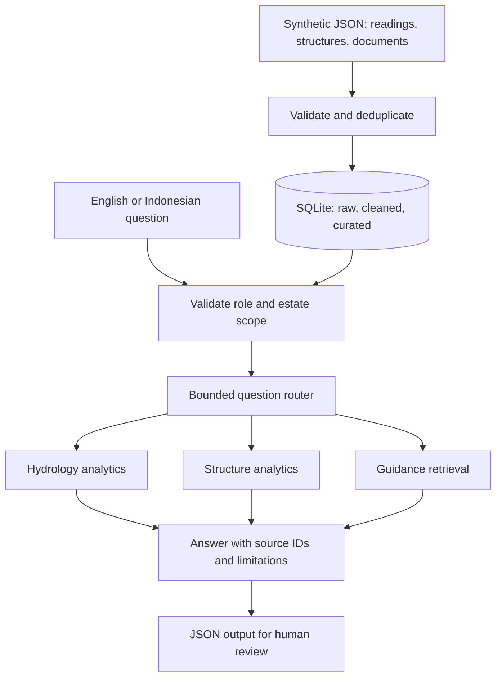

# Water Management Assistant

A small, runnable portfolio adaptation of a water-management data and assistant workflow. It brings hydrological readings, water-structure inventory and reference guidance into one local analytical store, then answers supported English and Indonesian questions with traceable evidence.

**Python 3.11+ · standard library only · no API keys · entirely synthetic data**

This portfolio project is presented by Frederick Alfhendra and developed with AI assistance for coding, tests and documentation. It demonstrates the architecture and workflow locally. It is not a copy of a customer deployment, and it does not claim production results or individual responsibility for every part of a customer implementation. All included names, records and guidance are synthetic. Original customer documents, credentials and infrastructure details are excluded.

## Run in two minutes

Clone the repository, enter its directory, then run:

```sh
python -m water_management ingest samples/input.json
python -m water_management ask "summary"
python -m water_management ask "ringkasan kondisi air" --role field --estate ESTATE_A
python -m water_management ask "tampilkan sop air tinggi" --role field --estate ESTATE_A
python -m unittest discover -s tests -v
```

On Windows, `py -3` can replace `python`. No package installation or cloud account is required. The first command creates `data/water.sqlite3`. To use another database, place `--db PATH` **before** the subcommand.

```sh
python -m water_management --db data/demo.sqlite3 ingest samples/input.json
python -m water_management --db data/demo.sqlite3 ask "show overdue structures" --output data/result.json
python -m water_management questions
```

Answers are printed as JSON; `--output` saves the same answer. The database holds one current dataset: successful ingestion replaces all three zones in a single transaction. Failed validation leaves the previous dataset intact.

## Sample input and actual output

The [input fixture](samples/input.json) contains two fictional estates, three monitored blocks, eight unique daily observations, three structures and three synthetic guidance documents. It intentionally repeats one observation to demonstrate exact deduplication.

Input excerpt:

```json
{
  "id": "R003",
  "estate": "ESTATE_A",
  "block": "A01",
  "date": "2026-10-15",
  "rainfall_mm": 120,
  "water_level_cm": 95,
  "groundwater_depth_cm": 20
}
```

For `python -m water_management ask "summary"`, the generated output includes:

| Finding | Result | Evidence |
|---|---|---|
| High water at ESTATE_A / A01 | 95 cm > demo threshold 80 cm | R003 |
| Heavy rain at ESTATE_A / A01 | 120 mm > demo threshold 100 mm | R003 |
| Deep groundwater at ESTATE_A / A02 | 70 cm > demo threshold 60 cm | R006 |
| Stale observation at ESTATE_B / B01 | 4 days old as of 2026-10-15 | R008 |
| Overdue and over-budget structure | WS001 | WS001 |
| Total planned budget / spend | USD 23,000 / USD 15,500 | WS001–WS003 |

An alert excerpt from the actual output:

```json
{
  "code": "HIGH_WATER",
  "estate": "ESTATE_A",
  "block": "A01",
  "source_id": "R003",
  "date": "2026-10-15",
  "metric": "water_level_cm",
  "value": 95,
  "threshold_gt": 80,
  "action": "Verify the reading and request supervisor review; no equipment action is authorized."
}
```

Full outputs are generated by executing the public CLI, not handwritten:

| Scenario | Output |
|---|---|
| Ingestion and duplicate removal | [output_ingest.json](samples/output_ingest.json) |
| All-estate management summary | [output_management.json](samples/output_management.json) |
| Field summary for ESTATE_A only | [output_field.json](samples/output_field.json) |
| Structure inventory and overdue IDs | [output_inventory.json](samples/output_inventory.json) |
| Indonesian SOP request | [output_sop.json](samples/output_sop.json) |
| No matching SOP in the selected estate | [output_no_data.json](samples/output_no_data.json) |
| Unsupported forecast request | [output_unsupported.json](samples/output_unsupported.json) |
| Missing field scope | [output_invalid_scope.json](samples/output_invalid_scope.json) |

Regenerate them with `python scripts/generate_samples.py`. This uses a temporary database and does not modify your demo database.

## What the assistant supports

| Capability | English question | Indonesian question |
|---|---|---|
| Consolidated summary | `summary` | `ringkasan kondisi air` |
| Readings, changes and flags | `show rainfall and water levels` | `tampilkan curah hujan dan tinggi muka air` |
| Inventory and exception lists | `show water structures` | `tampilkan bangunan air` |
| Overdue inventory view | `show overdue structures` | `tampilkan bangunan terlambat` |
| Monitoring guidance | `show monitoring sop` | `tampilkan sop pemantauan` |
| High-water guidance | `show high water sop` | `tampilkan sop air tinggi` |

The overdue question returns the full inventory with an explicit overdue-ID list. Questions are matched against a documented phrase set after normalizing whitespace, case and trailing punctuation. This is a **bounded deterministic assistant**, not an LLM or general natural-language query engine. Indonesian and English phrases route to the same structured result; the evidence text is not machine translated. Unrecognized questions return `unsupported_question`, and missing scoped evidence returns `no_data`.

## Architecture



All queries use the curated zone. Scope filtering happens before analytics and retrieval, so a field query for ESTATE_A cannot include ESTATE_B records in calculations or citations. See [architecture and production boundaries](docs/ARCHITECTURE.md).

The CLI role and estate are **caller-supplied simulation inputs**, not authentication. Anyone with local access can choose management mode or read the SQLite file. A production API would derive access scope from a verified identity and enforce it server-side. No claim of production tenant security is made here.

## Data contract and rules

Top-level keys are exactly `dataset_id`, `as_of`, `readings`, `structures`, `documents`. Dates use `YYYY-MM-DD`. IDs use uppercase letters, digits, underscores or hyphens, beginning with a letter, up to 40 characters. Each collection permits at most 10,000 rows; the input file is capped at 5 MB. Unknown fields are rejected.

| Collection | Required fields |
|---|---|
| readings | `id`, `estate`, `block`, `date`, `rainfall_mm`, `water_level_cm`, `groundwater_depth_cm` |
| structures | `id`, `estate`, `type`, `status`, `planned_completion`, `budget_usd`, `spent_usd` |
| documents | `id`, `estate`, `title`, `text` |

Rainfall accepts 0–2,000 mm per daily observation. Gauge water levels accept -1,000–1,000 cm relative to a synthetic local datum. Groundwater depth accepts 0–1,000 cm below ground. These are input bounds, not environmental standards. Numbers must be finite and cannot be booleans. Future observations are rejected relative to the explicit dataset `as_of`, so results do not change with the machine clock.

Only one reading per estate/block/day is supported. Exact repeated IDs are removed; conflicting IDs or two different IDs for the same block-day fail validation. Structure types are `sluice_gate`, `culvert`, `weir`; statuses are `planned`, `in_progress`, `completed`. Money is USD, nonnegative, at most one billion per record and at most two decimal places. Totals use decimal arithmetic and return decimal strings.

Hydrological flags use the latest observation per block. The high-water, heavy-rain and deep-groundwater checks are strict `>` comparisons against the demo thresholds above. Readings more than two days old also receive a freshness flag. A stale observation can carry historical threshold flags; its date and age are retained. Structure completion is overdue only when unfinished and its planned date is strictly before `as_of`.

Missing days are not interpolated or treated as zero rainfall. Mean rainfall is computed per observed block-day, not an estate-wide rainfall total. Water-level change is the difference between the last and first observation; a single observation returns `null`. There is no forecast, causality claim, regulatory assessment, pump control or gate actuation.

## Reliability and validation

Run `python -m unittest discover -s tests -v`. Tests cover exact sample calculations, source evidence, field isolation, bilingual routing, unsupported questions, absent SOPs, invalid numeric values, future dates, duplicate conflicts, threshold boundaries, empty data, atomic replacement and public CLI execution. CI runs tests and checks regenerated examples on Python 3.11, 3.12 and 3.13.

Invalid input and local I/O failures return structured errors with exit code 1. Unsupported questions and missing data are successful requests with explicit status and exit code 0. Error output omits raw records and filesystem paths. SQLite stores synthetic inputs in plaintext; it is not an encrypted or audited production data platform. See [validation evidence](docs/VALIDATION.md).

## Why this scope

The demo emphasizes a shared data foundation, validated ingestion, independent analysis functions, scoped retrieval and evidence-bearing output—the same engineering concerns demonstrated in the companion wealth-advisor portfolio, applied to a different domain. A small deterministic implementation makes the logic inspectable and reproducible without paid services.

The extension path is explicit: replace JSON ingestion with source-system adapters, local persistence with a governed analytical store, and the bounded router with a constrained model-backed interface. Keep numerical calculations, scope enforcement and evidence generation in tested code. Add identity, observability and evaluation before exposing it to real users.

## Repository map

```text
water_management/
  data.py          Contract validation and transactional data zones
  analytics.py     Hydrology and structure metrics
  assistant.py     Scope, bilingual routing, retrieval and evidence
  __main__.py      CLI and structured failures
samples/           Synthetic input and eight generated outputs
tests/             Unit and CLI integration tests
scripts/           Example regeneration
docs/              Architecture, validation and portfolio description
```

See [portfolio description and contribution note](docs/PORTFOLIO.md) for a short introduction suitable for linking from an application.
